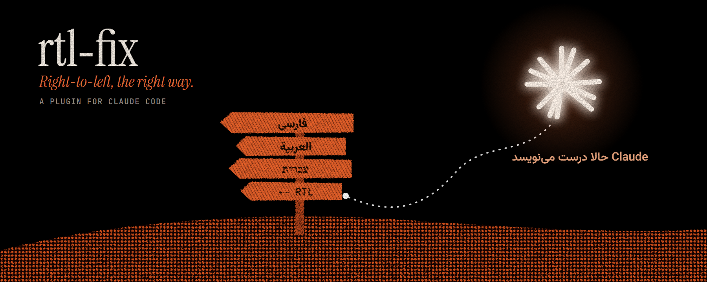
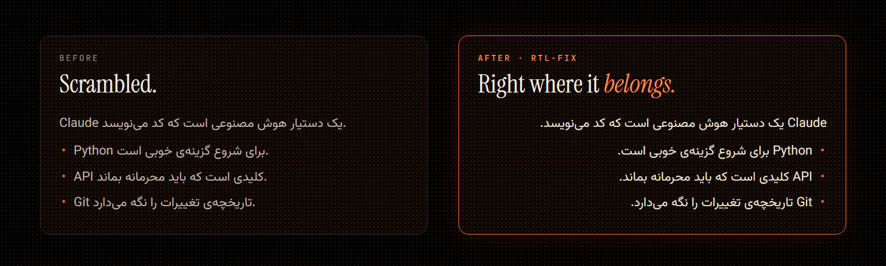

<p align="center">
  
</p>

<p align="center">
  <a href="#install"></a>
  <a href="LICENSE"></a>
  
</p>

<p align="center">
  <b>English</b> &nbsp;·&nbsp; <a href="#فارسی">فارسی</a>
</p>

<br>

> **Claude writes Persian beautifully, until a line starts with `Claude`, `Python` or `API`.**
> That line flips left-to-right, and the sentence comes out scrambled.
> `rtl-fix` puts it back where it belongs.

<br>

<p align="center">
  
</p>

## Why it happens

A renderer picks each paragraph's direction from its **first strong character**. A Persian sentence that opens with an English word is treated as an English paragraph, so the line is laid out left-to-right, the punctuation jumps to the wrong end, and list bullets land on the wrong side.

## What rtl-fix does

Before each reply is saved and shown, `rtl-fix` adds one invisible character, the **Right-to-Left Mark** (`U+200F`), to the start of every line that holds RTL letters. That mark is the line's first strong character, so the line stays right-to-left.

|  |  |
| --- | --- |
| 🧭 **Markdown-aware** | Puts the mark after list bullets, numbers, headings, quotes and task boxes, and at the start of every table cell |
| 🧱 **Leaves code alone** | Fenced code blocks and English-only lines pass through unchanged |
| 🔒 **Local and tiny** | No network, no file access, no commands, no settings. About 60 lines you can read in a minute |
| ♻️ **Safe to repeat** | A line that already has the mark is left as it is |

## Install

**Terminal**, at the prompt of a Claude Code session:

```
/plugin install rtl-fix --marketplace PersianXM/claude-rtl-fix
```

**Shell:**

```bash
claude plugin install rtl-fix --marketplace PersianXM/claude-rtl-fix
```

**Claude desktop app:** click **+** next to the prompt box → **Plugins** → **Add marketplace** → `PersianXM/claude-rtl-fix` → **Add plugin**.

Answer `y` to add the marketplace, then choose the **user** scope so it works in every session. To turn it off later:

```bash
claude plugin disable rtl-fix@claude-rtl-fix
```

## Good to know

- The mark lives in the reply text itself, so text copied out of a reply carries the invisible `U+200F` characters with it.
- It works in Claude Code (the CLI and the desktop app's **Code** tab), not in the claude.ai chat.
- It needs a Claude Code build that supports plugin hooks modules (2.1.3xx or newer).
- This is a community plugin. It is not made or endorsed by Anthropic.

<br>

---

<div dir="rtl">

<h2 id="فارسی">فارسی</h2>

> **Claude فارسی را زیبا می‌نویسد، تا وقتی که خطی با `Python` یا `API` شروع شود.**
> آن خط چپ‌به‌راست می‌شود و جمله به هم می‌ریزد. `rtl-fix` آن را سر جایش برمی‌گرداند.

### چرا این اتفاق می‌افتد؟

جهت هر پاراگراف از **اولین حرف قوی** آن تعیین می‌شود. وقتی جمله‌ی فارسی با یک کلمه‌ی انگلیسی شروع شود، کل خط انگلیسی فرض می‌شود و چپ‌به‌راست چیده می‌شود. نقطه به سر دیگر خط می‌رود و بولت فهرست هم سمت اشتباه قرار می‌گیرد.

### rtl-fix چه می‌کند؟

پیش از ذخیره و نمایش هر پاسخ، یک نویسه‌ی نامرئی به نام **RLM** (U+200F) اول هر خطی می‌گذارد که حرف فارسی، عربی یا عبری دارد. این نویسه اولین حرف قوی خط می‌شود و جهت خط راست‌به‌چپ می‌ماند.

- 🧭 بعد از نشانه‌های مارک‌داون هم درست کار می‌کند: فهرست‌ها، تیترها، نقل‌قول‌ها و خانه‌های جدول
- 🧱 به بلوک‌های کد و خط‌های تمام‌انگلیسی دست نمی‌زند
- 🔒 کاملاً محلی اجرا می‌شود: به اینترنت وصل نمی‌شود، فایلی نمی‌خواند و دستوری اجرا نمی‌کند
- ♻️ اگر خطی از قبل این نویسه را داشته باشد، دوباره اضافه نمی‌کند

### نصب

در ترمینال:

</div>

```bash
claude plugin install rtl-fix --marketplace PersianXM/claude-rtl-fix
```

<div dir="rtl">

در اپ دسکتاپ Claude: دکمه‌ی **+** کنار کادر پیام ← **Plugins** ← **Add marketplace** ← وارد کردن `PersianXM/claude-rtl-fix` ← **Add plugin**.

برای اینکه در همه‌ی جلسه‌ها کار کند، گزینه‌ی **user** را انتخاب کنید.

### خوب است بدانید

- این نویسه‌ی نامرئی در خود متن پاسخ ذخیره می‌شود. پس اگر متن را کپی کنید، همراهش کپی می‌شود.
- فقط روی Claude Code کار می‌کند (ترمینال و تب **Code** اپ دسکتاپ)، نه روی چت claude.ai.
- این یک افزونه‌ی جامعه است و Anthropic آن را نساخته یا تأیید نکرده است.

</div>

<br>

<p align="center">
  <sub>MIT © Ali Rashedi &nbsp;·&nbsp; If it helped, a ⭐ helps others find it.</sub>
</p>
